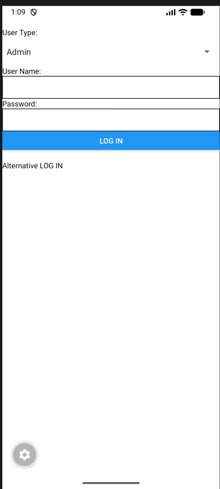

# Login App

A simple login screen app made with React Native and Expo. The user picks a user type, enters a user name and password, and logs in. The app shows a welcome message using a Toast.

# Features Highlight

- **Picker** (from `@react-native-picker/picker`) to choose User Type: Admin or Guest
- **Custom component `InputBox`** that combines a label and a TextInput, reused for User Name and Password
- **useState** to save the user type, user name and password
- **LOG IN button** that shows a Toast with the user type and name (e.g. "Welcome Admin Bob")
- **TouchableOpacity "Alternative LOG IN"** that checks the password. If it's correct, it shows the welcome Toast. If not, it shows "Error! Wrong Password!"
- **ToastAndroid** used instead of Alert for the messages

# ScreenShots of App

Screenshots:  

# Demo Video

Demo Video Link:  
(IN POLITEMALL SUBMISSION)